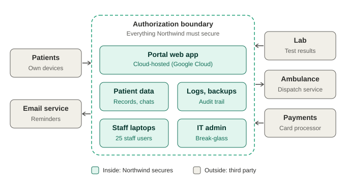

# 4. Authorization boundary and connections

The dashed line is the authorization boundary. Everything inside is what Northwind must secure and document. Everything outside is a connection that is managed through agreements and by limiting what data crosses it.

## Connections

| Connection | What flows | Direction | Inside or outside |
|---|---|---|---|
| Staff laptops | Staff logging in to read and write records | Staff to portal | Inside |
| Patients’ own devices | Patient logins and requests | Patient to portal | Outside |
| Email service | Appointment reminders and notifications | Portal to patients | Outside |
| Lab system | Test results | Lab to portal | Outside |
| Ambulance dispatch | Pickup location, patient details | Portal to dispatch | Outside |
| Payment processor | Payment confirmation only | Processor to portal | Outside |

**Test used for inside or outside:** can Northwind’s IT admin configure it, patch it, and manage its accounts? If yes, it is inside. If another organization runs it, it is outside, even if Northwind depends on it.

## Inside the boundary

The cloud-hosted portal application, patient data, logs and backups, staff laptops, and the IT admin.

## Concerns recorded

- **Ambulance dispatch:** availability and confidentiality of location.
- **Lab connection:** integrity of results flowing into patient records.
- **Payment processor:** lower risk, because card numbers are never stored by Northwind.

## Inherited protection

Google Cloud secures its data centers and underlying infrastructure. See [evidence notes](../evidence/README.md).

## Planned improvements (Project 2)

The diagram does not yet show the firewall or web application firewall in front of the portal, network zones for staff laptops, or the secure path (MFA or VPN) for staff and admin access. These will be built and documented in the network lab.
